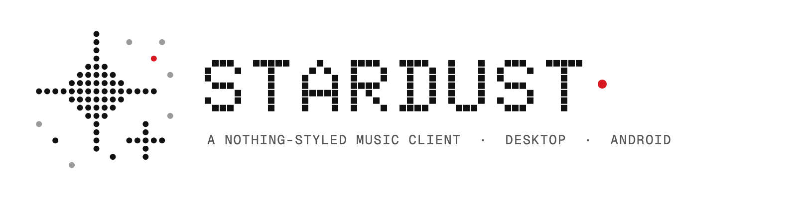

<p align="center">
  <picture>
    <source media="(prefers-color-scheme: dark)" srcset=".github/assets/banner-dark.png">
    
  </picture>
</p>

<p align="center">
  A Nothing-styled Deezer client for <b>macOS</b>, <b>Windows</b>, <b>Linux</b> and <b>Android</b> (with Android Auto),<br>
  built on <a href="https://github.com/Sheathed/Saturn">Saturn</a>.
</p>

<p align="center">
  <a href="https://github.com/elevensixtyfour/stardust-releases/releases?q=desktop"><b>Desktop downloads</b></a>
  &nbsp;·&nbsp;
  <a href="https://github.com/elevensixtyfour/stardust-releases/releases?q=android"><b>Android downloads</b></a>
</p>

---

Stardust rebuilds Saturn in the visual language of Nothing's apps: dot-matrix type, monospaced labels,
monochrome surfaces and a single red accent, in light and dark. On top of that it adds speaker casting,
a better car experience and a proper offline mode.

> A Deezer Premium account is required for Deezer playback.

## What's different from Saturn

**Everywhere**
- Nothing-inspired design and a dot-matrix Stardust logo
- **Music Assistant casting** — play to Sonos, Chromecast, AirPlay and other speakers on your network, with play/pause, seek, skip and volume
- **In-app updates** from this page (Settings → Updates)

**macOS, Windows and Linux**
- **Lossless playback that sticks** — fixed tracks silently dropping to MP3 320 when FLAC is selected
- **Linux builds** (AppImage and .deb) that don't depend on your system's OpenSSL

**Android**
- **Android Auto redesign** — Home, Recents, Library and Downloads tabs, search and voice ("Hey Google, play … on Stardust"), cover art everywhere, and playback always moves to the car
- **Offline mode** — switches on by itself when you lose signal; only downloaded music plays, the rest is greyed out
- Music Assistant **auto-reconnect**, and casting that works on home Wi-Fi or over Tailscale

## Install

| Platform | File | Notes |
| --- | --- | --- |
| macOS (Apple Silicon / Intel) | `Stardust-v…-mac-arm64.dmg` / `-mac-x64.dmg` | Drag to Applications. The app isn't notarized: the first time, right-click it → **Open**. |
| Windows | `Stardust-v…-win-setup.exe` or `-win-portable.exe` | Installer, or a single file that runs without installing. |
| Linux | `Stardust-v…-linux-x86_64.AppImage` or `-linux-amd64.deb` | AppImage: `chmod +x` and run (updates itself). The .deb is for Ubuntu, Debian, Mint and similar. |
| Android | `Stardust-Android-v….apk` | Allow installs from your browser when asked. |

**Linux in one command** (Arch, EndeavourOS, Manjaro, Ubuntu, Debian, Mint, Fedora, openSUSE) — installs the latest
AppImage for your user, the libraries it needs, and an app-menu entry; Stardust then updates itself:

```bash
curl -fsSL https://raw.githubusercontent.com/elevensixtyfour/stardust-releases/main/install.sh | bash
```

To uninstall: `curl -fsSL https://raw.githubusercontent.com/elevensixtyfour/stardust-releases/main/install.sh | bash -s -- --uninstall`

**Android Auto:** apps installed outside the Play Store are hidden until you enable them. In Android Auto's
settings tap **Version** 10 times, then ⋮ → **Developer settings** → turn on **Unknown sources**.

## Credits

Stardust is developed by **elevensixtyfour**. It's a fork of [Saturn](https://github.com/Sheathed/Saturn) by
Sheathed and contributors, itself based on the original Freezer app, and is licensed under the GPL-3.0.
Fonts: Doto and Geist Mono (OFL).
